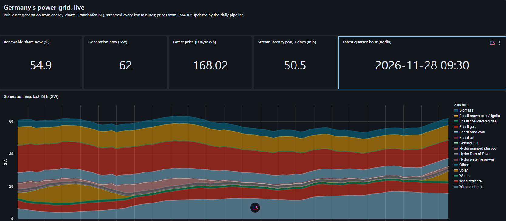
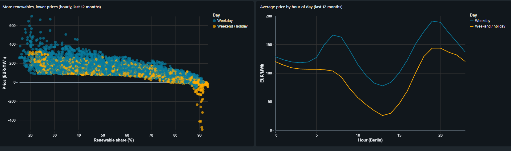
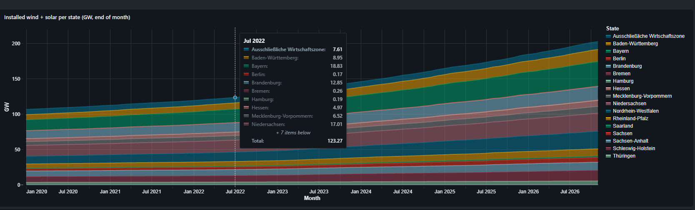

# GridPulse

Real-time energy market lakehouse on Databricks for the German electricity grid.

GridPulse combines live grid data, weather, historical market data, a power-plant registry and a smart-meter event stream into one governed lakehouse. It answers questions like *what share of German power is renewable right now?* and *why do electricity prices go negative?*

> 🚧 Work in progress. Built step by step; see [`docs/decisions.md`](docs/decisions.md) for design decisions as they are made.

## Planned stack

| Area | Tools |
|---|---|
| Ingestion | Python, GitHub Actions |
| Streaming | Kafka (Redpanda) |
| Lakehouse | Databricks, Delta Lake, Unity Catalog |
| Processing | Auto Loader, Structured Streaming, Lakeflow Declarative Pipelines |
| Transformation | dbt |
| ML / AI | MLflow, LLM ops agent |
| Serving | AI/BI dashboards, Genie |
| DevOps | Databricks Asset Bundles, Terraform (AWS), pytest, ruff |

## First findings

From the gold tables (`gold.agg_renewable_share_daily`, `gold.agg_negative_price_hours`), German day-ahead market DE-LU, SMARD data:

| Year | Renewable share of generation | Hours with negative prices | Avg. solar share in those hours | Lowest price (EUR/MWh) |
|---|---|---|---|---|
| 2020 | 46.3 % | 298 | 14.8 % | -83.9 |
| 2021 | 41.9 % | 139 | 21.0 % | -69.0 |
| 2022 | 46.7 % | 69 | 18.8 % | -19.0 |
| 2023 | 55.5 % | 301 | 25.9 % | -500.0 |
| 2024 | 58.5 % | 457 | 42.7 % | -135.5 |
| 2025 | 58.9 % | 588 | 50.7 % | -250.3 |
| 2026* | 60.4 % | 563 | 57.5 % | -500.0 |

\* 2026 until 21 November.

- **Negative prices have become a solar story.** In 2020 solar supplied about 15 % of generation during negative-price hours; in 2026 it is about 58 %. Negative prices moved from windy nights and holidays to sunny middays.
- **Cross-check against official figures:** the pipeline reproduces the Bundesnetzagentur's published counts of negative-price hours exactly (69 in 2022, 301 in 2023, 457 in 2024) and the 2024 minimum price of -135.45 EUR/MWh. The renewable share differs from the official 2024 value (59.0 %) by 0.5 points, because pumped storage is counted in total generation here.
- **2021 was a weak wind year**, visible as a dip in the renewable share.

From 2025 on, hours with at least one negative quarter-hour are counted (the day-ahead market moved to 15-minute prices), so 2025–2026 counts can be higher than hourly-based official figures.

### Where Germany builds solar and wind

From `gold.fact_installed_capacity` (MaStR power-plant register, export of 22 Nov 2026; units ≥ 100 kW one by one, smaller units summed), installed capacity at month end, net:

| State | Solar 2020 → Oct 2026 (GW) | Wind 2020 → Oct 2026 (GW) | Added (GW) |
|---|---|---|---|
| Bayern | 13.8 → 31.5 | 2.5 → 2.9 | +18.1 |
| Nordrhein-Westfalen | 5.5 → 14.3 | 6.1 → 10.1 | +12.9 |
| Niedersachsen | 4.3 → 10.7 | 11.5 → 14.7 | +9.6 |
| Baden-Württemberg | 6.3 → 14.8 | 1.6 → 2.3 | +9.2 |
| Brandenburg | 4.0 → 9.1 | 7.5 → 9.7 | +7.3 |
| Schleswig-Holstein | 1.7 → 4.8 | 6.8 → 10.2 | +6.5 |
| Offshore zone (North and Baltic Sea) | – | 7.6 → 11.1 | +3.5 |

- **The south builds solar, the north builds wind.** Bavaria added the most capacity of any state, almost all of it solar; its wind capacity barely moved. NRW added the most onshore wind (+4.0 GW), matching the Bundesnetzagentur's report that most new turbines in 2025 went up there.
- **Cross-check:** wind at the end of June 2026 is 80.8 GW (onshore + offshore) against 80.85 GW official. Solar is 111.9 GW against 125.4 GW official; the register's net capacity (inverter limit) is used here, while official solar figures are most likely based on gross module capacity (about 10 % higher).
- **Rooftops matter:** 54 of the 112 GW of solar come from systems below 100 kW.

### Streaming: latency and throughput

From `ops.stream_metrics` (Kafka on Redpanda Serverless, measured 24 Nov 2026, pipeline started right after sending):

| Measure | p50 | p95 |
|---|---|---|
| Producer → broker (Redpanda, `LogAppendTime`) | 0.05 s | 0.05 s |
| Producer → bronze table (end to end) | 2.9 min | 3.4 min |
| Throughput (meter replay at 1 day per minute) | 36 messages/s | |

- **The transport is fast; the wait is by design.** Almost all of the ~3 minutes is waiting for the triggered pipeline and serverless start-up. Running the pipeline continuously would cut it to seconds but keep compute running all day; for a portfolio on free tiers the daily refresh is the right trade-off.
- **Source delay:** energy-charts publishes values about 2 hours after the quarter-hour they describe.
- **Replays don't double-count:** a third replay of the same day added 2,304 messages to bronze and 0 new events to silver and gold.

### Dashboard

A three-page Databricks AI/BI dashboard, kept as code (`dashboards/build_dashboard.py`) and deployed by the bundle with every merge and release.

**Live grid:** renewable share, generation and price now, stream latency, and the generation mix of the last 24 hours (live stream).



**Market:** prices fall as the renewable share rises; deeply negative prices only appear above ~88 % renewables, mostly on weekends and holidays. Weekday prices peak in the morning and evening; the midday solar dip is much deeper on weekends.



**Capacity and consumption:** installed wind and solar per state since 2020, the latest split by state, German grid load and London household load by hour.



### Compute usage and cost

From `ops.rpt_compute_usage_daily`, a dbt view over Databricks' system tables (`system.billing.usage`, `list_prices`, `system.lakeflow.*`). Free Edition bills nothing; the dollar figures are what the same usage would cost at **list price** on a paid plan.

**November 2026 (build month), 70.5 DBU ≈ $34 at list price:**

| Workload | DBU | List price |
|---|---|---|
| Dev daily job `gridpulse_refresh` (ingestion, checks, dbt) | 20.4 | $7.13 |
| Dev pipeline `gridpulse_medallion` (bronze, silver, SCD2) | 18.6 | $6.52 |
| SQL warehouse (dbt, CI builds, ad-hoc queries) | 20.4 | $14.27 |
| Notebooks and predictive optimization | 8.2 | $4.61 |
| Prod release runs (`v0.1.0`, `v0.1.1`) | 2.2 | $0.77 |
| Forecast job, simulators, replays | 0.7 | $0.25 |

- **Daily build days ran 10–14 DBU** (21–27 Nov: history backfills, full refreshes, many test runs and CI builds).
- **Steady state is far lower:** a normal day is one scheduled refresh (pipeline + dbt) plus eight forecast runs; 28 Nov, with that run plus one deploy run, used 2.5 DBU. So running GridPulse costs roughly **1–2 DBU per day, about 30–60 DBU (~$12–25 at list price) per month**, to be confirmed with December's data.
- **The SQL warehouse costs about twice as much per DBU as jobs compute** (~$0.70 vs ~$0.35). Slim CI (only changed models) and triggered pipelines instead of continuous ones are the main levers that keep it low.

## Data lineage (dbt)

Silver tables (green) flow through staging views into the gold star schema and the answer tables:


## Repository layout

```
resources/          Databricks job and pipeline definitions
ingestion/          Producers and batch ingesters (run on GitHub Actions)
src/                Pipeline code (bronze, silver), ML, ops agent, shared utils
dbt/                dbt project for the gold layer
tests/              Unit tests
infra/terraform/    AWS infrastructure
dashboards/         Exported dashboards
docs/               Design decisions and documentation
```

## Local development

```bash
python -m venv .venv
source .venv/bin/activate        # Windows: .venv\Scripts\activate
pip install -r requirements-dev.txt
ruff check . && ruff format --check . && pytest
```

## Data sources

All data comes from free public sources: Energy-Charts (Fraunhofer ISE), SMARD (Bundesnetzagentur), Open-Meteo, Marktstammdatenregister and the Smart Meters in London dataset (Kaggle). Full credits and licenses will be listed here.
