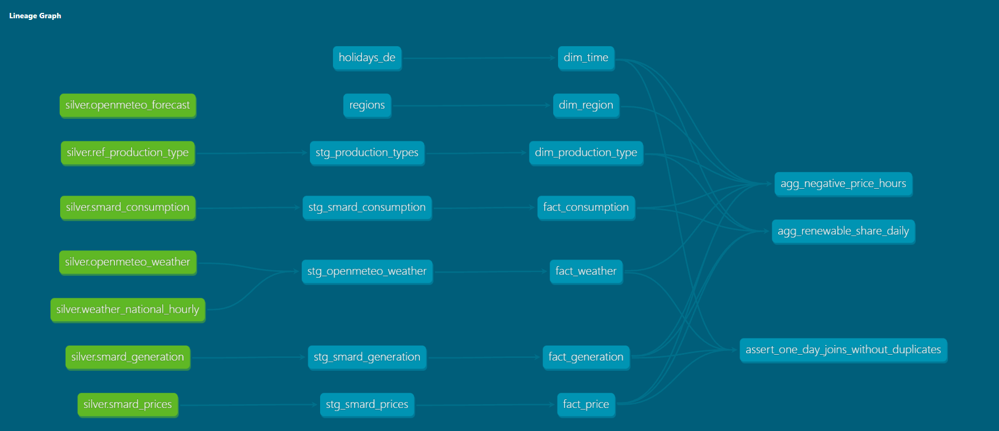

# GridPulse

Real-time energy market lakehouse on Databricks for the German electricity grid.

GridPulse combines live grid data, weather, historical market data, a power-plant registry and a smart-meter event stream into one governed lakehouse. It answers questions like *what share of German power is renewable right now?* and *why do electricity prices go negative?*

> 🚧 Work in progress. Built step by step; see [`docs/decisions.md`](docs/decisions.md) for design decisions as they are made.

## Planned stack

| Area | Tools |
|---|---|
| Ingestion | Python, GitHub Actions |
| Streaming | Kafka (Redpanda) |
| Lakehouse | Databricks, Delta Lake, Unity Catalog |
| Processing | Auto Loader, Structured Streaming, Lakeflow Declarative Pipelines |
| Transformation | dbt |
| ML / AI | MLflow, LLM ops agent |
| Serving | AI/BI dashboards, Genie |
| DevOps | Databricks Asset Bundles, Terraform (AWS), pytest, ruff |

## First findings

From the gold tables (`gold.agg_renewable_share_daily`, `gold.agg_negative_price_hours`), German day-ahead market DE-LU, SMARD data:

| Year | Renewable share of generation | Hours with negative prices | Avg. solar share in those hours | Lowest price (EUR/MWh) |
|---|---|---|---|---|
| 2020 | 46.3 % | 298 | 14.8 % | -83.9 |
| 2021 | 41.9 % | 139 | 21.0 % | -69.0 |
| 2022 | 46.7 % | 69 | 18.8 % | -19.0 |
| 2023 | 55.5 % | 301 | 25.9 % | -500.0 |
| 2024 | 58.5 % | 457 | 42.7 % | -135.5 |
| 2025 | 58.9 % | 588 | 50.7 % | -250.3 |
| 2026* | 60.4 % | 563 | 57.5 % | -500.0 |

\* 2026 until 21 November.

- **Negative prices have become a solar story.** In 2020 solar supplied about 15 % of generation during negative-price hours; in 2026 it is about 58 %. Negative prices moved from windy nights and holidays to sunny middays.
- **Cross-check against official figures:** the pipeline reproduces the Bundesnetzagentur's published counts of negative-price hours exactly (69 in 2022, 301 in 2023, 457 in 2024) and the 2024 minimum price of -135.45 EUR/MWh. The renewable share differs from the official 2024 value (59.0 %) by 0.5 points, because pumped storage is counted in total generation here.
- **2021 was a weak wind year**, visible as a dip in the renewable share.

From 2025 on, hours with at least one negative quarter-hour are counted (the day-ahead market moved to 15-minute prices), so 2025–2026 counts can be higher than hourly-based official figures.

## Data lineage (dbt)

Silver tables (green) flow through staging views into the gold star schema and the answer tables:



## Repository layout

```
resources/          Databricks job and pipeline definitions
ingestion/          Producers and batch ingesters (run on GitHub Actions)
src/                Pipeline code (bronze, silver), ML, ops agent, shared utils
dbt/                dbt project for the gold layer
tests/              Unit tests
infra/terraform/    AWS infrastructure
dashboards/         Exported dashboards
docs/               Design decisions and documentation
```

## Local development

```bash
python -m venv .venv
source .venv/bin/activate        # Windows: .venv\Scripts\activate
pip install -r requirements-dev.txt
ruff check . && ruff format --check . && pytest
```

## Data sources

All data comes from free public sources: Energy-Charts (Fraunhofer ISE), SMARD (Bundesnetzagentur), Open-Meteo, Marktstammdatenregister and the Smart Meters in London dataset (Kaggle). Full credits and licenses will be listed here.
